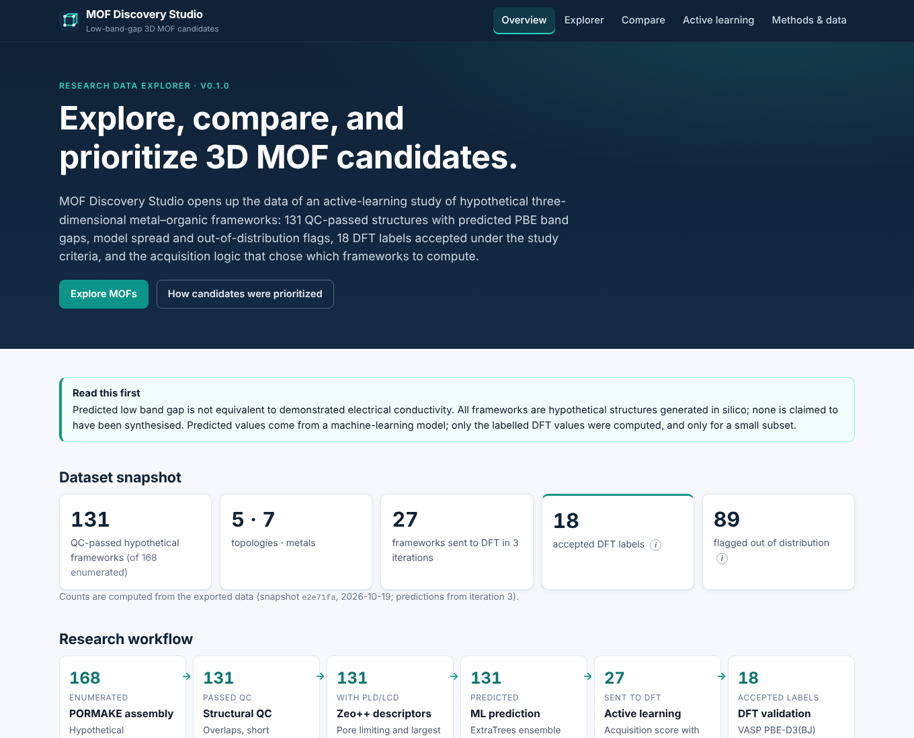
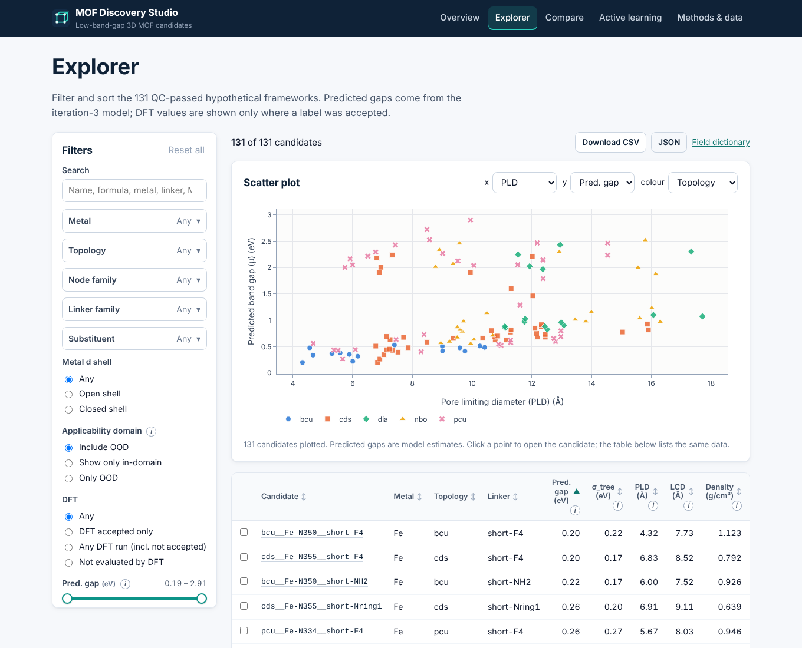
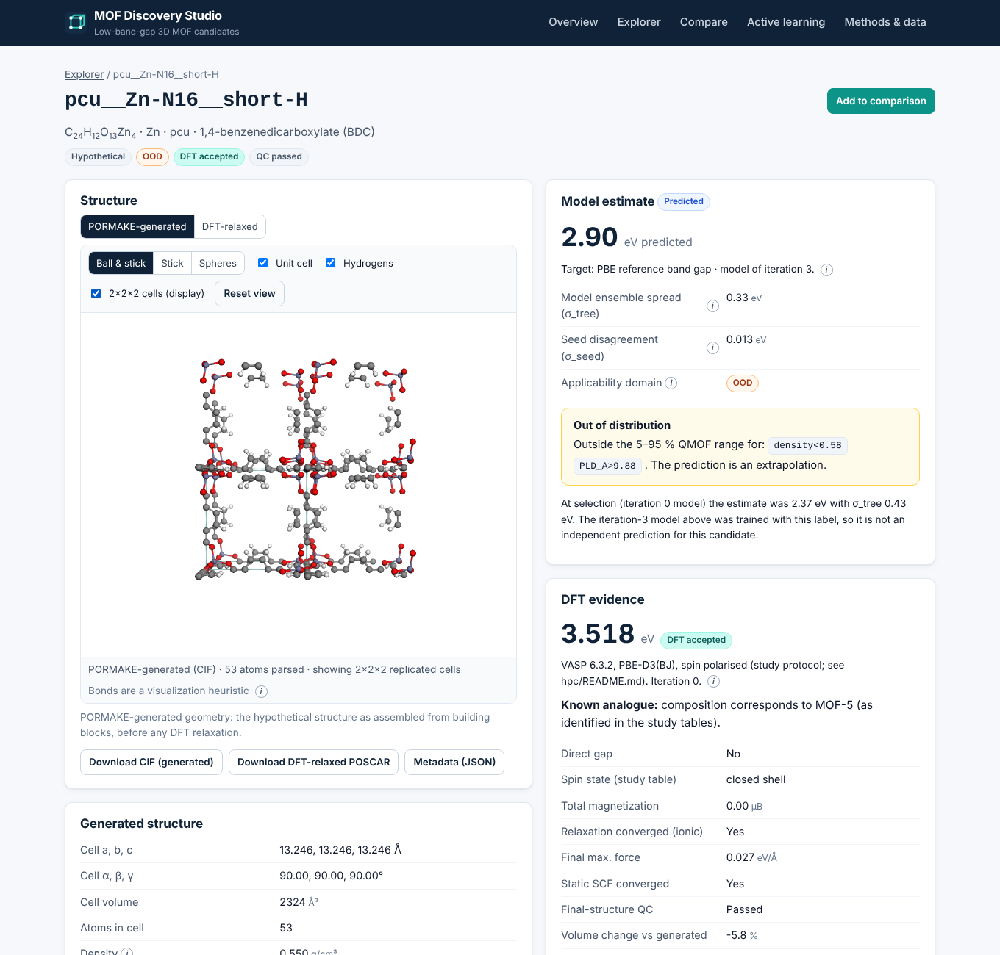
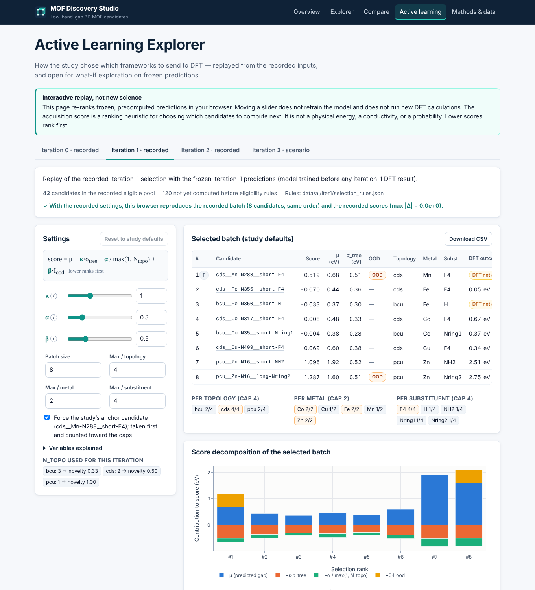

# MOF Discovery Studio

**Explore, compare, and prioritize 3D MOF candidates.**

MOF Discovery Studio is a static, browser-based interface to the data of the research project
[**Active learning for low-band-gap 3D metal–organic frameworks**](https://github.com/humbertogn-coder/MOF_3D_Generator)
(C. H. Guerrero Navarro, M. Ghotbi, P. B. Balbuena; Texas A&M University). It shows the real
QC-passed hypothetical frameworks of that study, their predicted PBE band gaps, model spread, and
out-of-distribution (OOD) flags, the DFT labels accepted under the study rules, 3D structures, and
the active-learning acquisition logic that chose which frameworks to compute.

> Predicted low band gap is not equivalent to demonstrated electrical conductivity. All frameworks
> are hypothetical. The site does not run DFT, retrain models or generate structures.

| | |
|---|---|
| Data snapshot | `MOF_3D_Generator` commit `e2e71fa` (2026-10-19), predictions of iteration 3 |
| Records | 131 QC-passed candidates (of 168 enumerated), 131 CIFs, 27 sent to DFT, 18 accepted labels, 18 DFT-relaxed geometries |
| Stack | React 19 + TypeScript + Vite 7, Plotly.js (basic bundle, lazy), 3Dmol.js 2.5.5 (lazy), static JSON |
| Backend / database / API keys | none |
| Licence | Website code MIT ([LICENSE](LICENSE)); study data CC-BY-4.0; research code MIT |

All counts above come from `public/data/release-manifest.json`. The UI reads them from there instead of hard-coding them.

## Features

- **Overview**: research summary, dataset snapshot, workflow with live counts, predicted gaps by topology with accepted DFT gaps overlaid, and level-of-theory context.
- **Explorer**: search; multi-select filters for metal, topology, node family, linker family and substituent; open/closed shell, OOD and DFT-status filters; range sliders for predicted gap, σ_tree, PLD, LCD and density, with explicit handling of missing values. Sortable, accessible table; configurable scatter plot (click a point to open the candidate); CSV/JSON export; compare up to 3 candidates.
- **Candidate detail**: 3Dmol.js viewer with ball-and-stick, stick and spheres styles, unit cell, hydrogens on/off, a display-only 2×2×2 replication, reset, and a WebGL/parse-failure fallback. Switch between the **PORMAKE-generated** CIF and the **DFT-relaxed** POSCAR (accepted labels only). Also shows model estimate, OOD reasons, DFT evidence with acceptance notes and spin solutions, QC, active-learning history, and provenance links to exact source rows. Downloads: CIF, POSCAR and JSON.
- **Compare**: 2–3 candidates side by side. Predicted and computed groups are kept separate, differing rows are highlighted, and one viewer has a switcher. Shareable URL (`/compare?ids=a,b`).
- **Active Learning Explorer**: replays iterations 0–2 from the recorded pools. The browser verifies that the recorded batches and scores are reproduced exactly. You can explore κ, α, β, batch size and caps, forced anchors and eligibility rules on the frozen iteration-3 predictions (scenario mode). The page shows score decomposition, diversity breakdown, skip reasons, Δrank against the defaults, and CSV export.
- **Methods & data**: generation and QC scope, descriptor units, model meaning (μ, σ_tree, σ_seed, OOD), DFT protocol and acceptance rules, distinctions, licences, attribution, publication status, snapshot and checksums.

## Quick start

```bash
# Node >= 20, Python >= 3.9
npm ci
npm run dev            # http://localhost:5173
```

The data bundle in `public/data/` is committed, so the site runs without the research repository.

### Production build and preview

```bash
npm run build          # type-check + Vite build -> dist/
npm run preview        # http://localhost:4173
```

### Regenerate the data bundle from the research repository

```bash
git clone https://github.com/humbertogn-coder/MOF_3D_Generator ../MOF_3D_Generator
git -C ../MOF_3D_Generator checkout e2e71fada04e9679f95fa07412854c82db0e3dc2   # frozen snapshot
python3 scripts/export_research_data.py --source ../MOF_3D_Generator --out public/data --docs docs
python3 scripts/validate_export.py public/data
```

The exporter uses only the Python standard library. It reads the source tables, never modifies the source repository, and refuses to write inside it. Set `EXPORT_TIMESTAMP` to get a byte-identical manifest. See [docs/DATA_PROVENANCE.md](docs/DATA_PROVENANCE.md) for the generated reconciliation report.

## Tests and checks

```bash
npm run check          # validate-data + typecheck + lint + unit tests + Python tests + build
npm run test           # Vitest: filters, acquisition (vs exported Python reference), CSV, paths, guardrail sync, UI primitives
npm run test:py        # pytest: exporter (synthetic + real data), replay vs recorded batches, cross-check vs ORIGINAL pandas code
npm run test:e2e       # Playwright (desktop + mobile) against the production preview
```

`test:py` runs its real-data tests when `MOF_SOURCE` (or `../MOF_3D_Generator`) is a checkout of the research repository. The cross-check against the original `src/mofal/acquisition.py` also needs `pandas`. For `test:e2e` on a fresh machine, run `npx playwright install chromium` once.

## Repository layout

```text
MOF_Discovery_Studio/
  index.html, vite.config.ts, tsconfig.json, eslint.config.js, playwright.config.ts
  src/
    app/          App (routes), Layout, DataContext, CompareContext
    components/   ui primitives, PlotlyChart (lazy), StructureViewer (lazy 3Dmol.js)
    pages/        Home, Explorer, CandidateDetail, Compare, ActiveLearning, Methods, NotFound
    lib/          types, data loading, filters, acquisition (TS port), csv, format, palette, guardrails
    styles/       global.css
  public/
    data/         release-manifest.json, candidates.json, active-learning.json, DATA_README.txt,
                  structures/pormake/*.cif, structures/dft/*.vasp
    _headers      Cloudflare Pages headers (ignored elsewhere)
  scripts/        export_research_data.py, validate_export.py, acquisition_ref.py
  tests/          unit/ (Vitest), e2e/ (Playwright), python/ (pytest)
  docs/           audit, provenance, limitations, guardrails, deployment, costs, release checklist, roadmap, log
  .github/workflows/ci.yml
```

## Deployment

The site is fully static, and `dist/` can be served by any static host. See [docs/DEPLOYMENT.md](docs/DEPLOYMENT.md) for Cloudflare Pages (preferred), Cloudflare Workers static assets and GitHub Pages, including base paths and SPA deep links. See [docs/COSTS.md](docs/COSTS.md) for operating costs: zero with free static hosting. **Do not publish before completing [docs/PUBLIC_RELEASE_CHECKLIST.md](docs/PUBLIC_RELEASE_CHECKLIST.md).** The manuscript is unpublished, and team approval is required.

## Scientific integrity

See [docs/SCIENTIFIC_LIMITATIONS.md](docs/SCIENTIFIC_LIMITATIONS.md) and [docs/SCIENCE_GUARDRAILS.md](docs/SCIENCE_GUARDRAILS.md). The guardrails file quotes every scientific tooltip verbatim, and a unit test keeps it in sync with `src/lib/guardrails.ts`.

## Citation

Until a DOI exists, cite the research repository (see its `CITATION.cff`):

> C. H. Guerrero Navarro, M. Ghotbi, P. B. Balbuena. *Active learning for low-band-gap 3D metal-organic frameworks (code and data)*, v0.1.0, 2026. https://github.com/humbertogn-coder/MOF_3D_Generator

The study is a manuscript in preparation; publication status and DOI are to be confirmed.

## Acknowledgements

The study used PORMAKE, Zeo++, scikit-learn, the QMOF database (Rosen et al., *Matter* 2021; *npj Comput. Mater.* 2022), VASP, ASE and pymatgen. The site uses 3Dmol.js (BSD-3-Clause; Rego & Koes, *Bioinformatics* 2015), Plotly.js (MIT), React (MIT) and React Router (MIT).

## Screenshots

| Overview | Explorer |
|---|---|
|  |  |
| **Candidate detail** | **Active Learning Explorer** |
|  |  |
